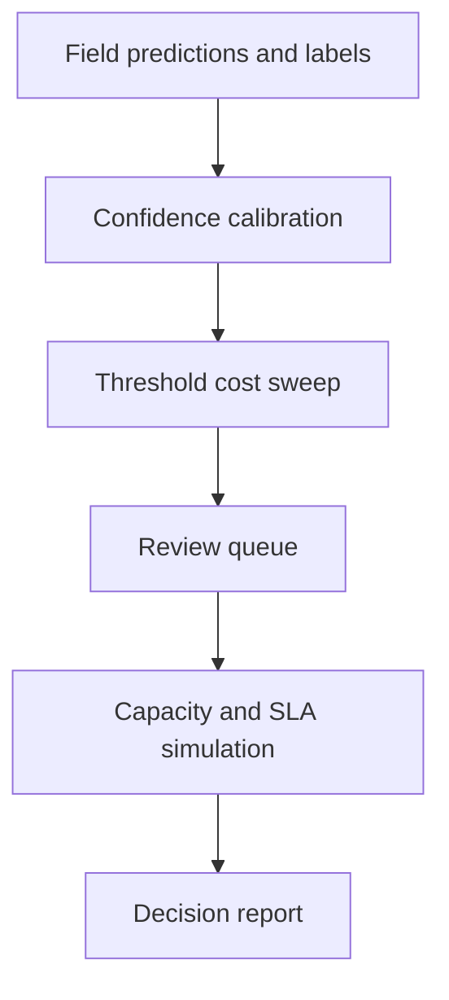

# Confidence Routing and Review-Queue Economics (QueueCal)

[](https://github.com/MadanMohan0537/confidence-routing-review-queue/actions/workflows/ci.yml)

**Decide which AI predictions to auto-approve and which to send to human reviewers: calibrate confidence, price errors against review time, and check whether the review queue still meets its SLA during a traffic surge.**

*Previously named `queuecal`. The Python package and CLI are still called `queuecal`. Note: this routes field predictions to **human reviewers**; it is not an LLM model router.*

---

## The problem

Teams that automate document or data extraction usually pick a confidence threshold by feel. A higher threshold means fewer automated errors but more human reviews. A threshold that looks cheapest on normal traffic can still overwhelm the review team during a surge, so the SLA can fail when volume is highest.

## Who it is for

Product and operations managers running human-in-the-loop AI workflows (for example receipt or invoice extraction), and the engineers who set automation thresholds.

## Approach

1. **Calibrate** raw confidence scores with histogram calibration and report expected calibration error. Raw confidence in this fixture is an overconfident score. Calibration is fit on the same rows it scores, so the calibrated error is in-sample.
2. **Sweep thresholds** and report automation rate, auto-approved errors, observed error cost, reviewer hours, and combined cost. Observed error cost is the sum of per-field costs on auto-approved fields whose label is wrong. Those costs are explicit inputs on each prediction. The demo fills them with synthetic defaults, and the CLI accepts report paths only.
3. **Simulate the review queue** with multiple reviewers, priorities, SLA breaches, maximum wait, and utilization.
4. **Choose a capacity-aware threshold** that prefers candidates with a simulated SLA breach rate of at most 5%, and compare it with the lowest-cost choice during a 3× surge. When every candidate is above 5%, the choice is the lowest breach rate, then the lowest total cost.

## What exists today

- Deterministic synthetic receipt fields (merchant, date, and total) with confidence, truth labels, error costs, arrivals, service times, and priorities.
- Histogram calibration, expected calibration error, a threshold sweep, a priority-queue preview, and a multi-reviewer queue simulation.
- A capacity-aware routing experiment with service-time sensitivity at 0.75×, 1×, and 1.5×.
- Markdown and JSON reports, and unit and experiment tests in CI on Python 3.11–3.13.

**Planned, not implemented:** real OCR/VLM extraction, a hosted review console, per-field thresholds, delayed-label joins, authentication, and production workflow integration.

## Quick start

Requires Python 3.11 or newer.

```bash
git clone https://github.com/MadanMohan0537/confidence-routing-review-queue.git
cd confidence-routing-review-queue
python -m venv .venv
source .venv/bin/activate
python -m pip install -e .
queuecal --json queuecal-report.json --markdown queuecal-report.md
```

Run tests:

```bash
python -m unittest discover -s tests -v
```

The `queuecal` command uses local synthetic data only. It needs no API key, model download, paid service, or private data, and it makes no network requests.

## Workflow



## Surge experiment

The experiment first picks the lowest-cost threshold on normal traffic. It then triples the arrival rate, keeping confidence, labels, costs, service times, and priorities fixed, and compares that threshold with a capacity-aware choice. The capacity-aware rule keeps candidates whose simulated SLA breach rate is at most 5% and picks the lowest total cost among them. On the bundled fixture every candidate is above 5%, so the tool returns the lowest breach rate, then the lowest cost, using the same queue-result fields as any other choice.

The JSON report includes the review denominator, breach count and rate, maximum wait, reviewer utilization, total cost, and expected calibration error, plus the service-time sweep. The markdown report includes the threshold curve (automation rate, auto-approved error count, observed error cost, reviewer hours, and total cost), the surge comparison (reviews, breach count and rate, maximum wait, and total cost), and that same sweep. Sweep rows are the threshold, breach rate, and total cost at 0.75×, 1×, and 1.5× service time.

The bundled demo test checks that capacity-aware routing has a lower breach count than the cost-only threshold. The 5% cap is the selection rule, and this fixture falls through it. Both reports show total cost for the two choices, and the markdown threshold curve shows observed error cost at each threshold. This validates simulator behavior, not production performance.

## Metrics it reports

All figures come from the synthetic fixture.

- JSON: expected calibration error, SLA breach count and rate, maximum wait, reviewer utilization, and total cost.
- Markdown threshold curve: automation rate, auto-approved error count, observed error cost, reviewer hours, and total cost.
- Markdown surge table: review count, breach count and rate, maximum wait, and total cost.

Observed error cost is the summed `error_cost` of auto-approved fields that are labeled incorrect. Review labor is priced with the hourly-rate argument on the sweep and the simulator. The two are added into total cost.

## Design choices

- One global threshold first, because it is easier to explain; per-field thresholds are planned.
- Error costs are explicit per-field values, and review labor uses an hourly-rate argument. The demo uses synthetic defaults. The CLI arguments are the JSON and Markdown report paths.
- Calibration is reported before routing. Histogram calibration is fit on the same rows used to compute expected calibration error, so that figure is in-sample.
- Capacity is tested under a 3× arrival surge, with the cost-only threshold chosen on normal traffic.
- Synthetic fixtures make the workflow reproducible. Published numbers are properties of this generator.

See [method and limitations](docs/METHOD.md), [synthetic-data provenance](data/README.md), and [backlog](docs/BACKLOG.md).

## Repository structure

```text
queuecal/         calibration, economics, queue simulation, reporting
tests/            deterministic unit and experiment tests
data/             synthetic-data provenance
docs/             methods, limitations, and backlog
.github/          CI across Python 3.11–3.13
```

## Deployment

Cloudflare Workers is the planned deployment target. This repository has no Worker, no `wrangler.toml`, and no workers.dev URL, so it is not deployed.

The deploy command, once a Worker exists, is:

```bash
npx wrangler deploy
```

Still needed before that command can run:

- a `wrangler.toml`
- a Worker entry point
- for this Python package, either Cloudflare Python Workers or a JavaScript/TypeScript port

## License

MIT
