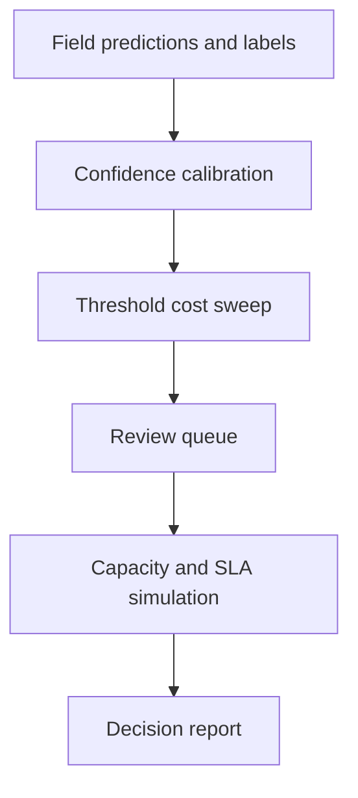

# QueueCal

[](https://github.com/MadanMohan0537/queuecal/actions/workflows/ci.yml)

QueueCal converts model confidence into an operations decision. It calibrates receipt-field scores, sweeps automation thresholds, prices auto-approved errors and human review, then tests whether the resulting review queue can actually meet its SLA during a traffic surge.

> **Project Lab traceability:** catalog Project 08, originally “Confidence Routing and Threshold Economics.” QueueCal is the product name; this metadata prevents the renamed idea from being built twice.

## Why it exists

Teams often choose a confidence threshold by feel. A higher threshold reduces automated errors but increases reviews; a threshold that is economically attractive in aggregate can still collapse the queue during a surge. QueueCal makes the cost table, capacity assumptions, and failure denominators visible.

## Implemented scope

- Deterministic synthetic receipt fields with confidence, truth labels, error costs, arrivals, service times, and priorities.
- Histogram calibration and expected calibration error.
- Threshold sweep with automation rate, auto-approved errors, expected error cost, reviewer hours, and combined cost.
- Priority review-queue preview.
- Deterministic multi-reviewer queue simulation with SLA breaches, maximum wait, and utilization.
- Markdown and JSON reports.
- **P1 capacity-aware routing:** choose a candidate threshold under a queue-breach constraint and compare it with the economic-only baseline during a three-times traffic surge.
- Service-time sensitivity at 0.75×, 1×, and 1.5×.

Real OCR/VLM extraction, a hosted review console, per-field optimization, delayed-label joins, authentication, and production workflow integration are planned—not implemented.

## Quick start

```bash
python -m venv .venv
source .venv/bin/activate
python -m pip install -e .
queuecal --json queuecal-report.json --markdown queuecal-report.md
```

Run tests:

```bash
python -m unittest discover -s tests -v
```

No API key, model download, network request, paid service, or private data is required.

## Workflow



## P1 experiment

The frozen experiment first selects the lowest-cost threshold on normal traffic. It then triples the arrival rate while keeping the predictions fixed and compares that threshold with capacity-aware choices constrained to at most five-percent simulated SLA breaches. The report records review denominator, breach count and rate, wait, utilization, total cost, and a service-time sensitivity sweep.

Acceptance is deliberately modest: capacity-aware routing must reduce the breach count when the economic-only threshold overloads the queue, while exposing any added error cost. If every candidate violates the SLA, QueueCal selects the least-bad breach rate and labels the scenario infeasible. This validates simulator behavior, not production performance.

## Design choices

- A global threshold is shipped first because it is easier to explain; per-field thresholds remain planned.
- Error costs are business-owned inputs instead of hidden model constants.
- Calibration is reported before routing because raw confidence is not probability.
- Capacity is evaluated under surge conditions rather than average demand.
- Synthetic fixtures make the workflow reproducible but prevent claims about real extraction accuracy.

See [the method and limitations](docs/METHOD.md), [synthetic-data provenance](data/README.md), and [the rigorous feature backlog](docs/BACKLOG.md).

## Repository structure

```text
queuecal/         calibration, economics, queue simulation, reporting
tests/            deterministic unit and experiment tests
data/             synthetic-data provenance
docs/             methods, limitations, and evidence-driven backlog
.github/           CI across Python 3.11–3.13
```

## License

MIT
